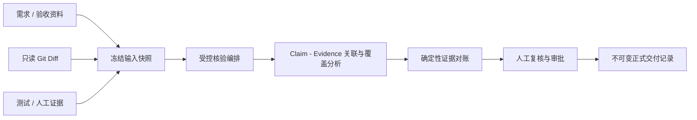

# DevProof

> 连接需求规划、PR 审查与交付证据的研发协作平台。

DevProof 将需求拆解、验收条件、GitHub PR 审查和交付记录串联起来。每轮审查固定需求资料、只读 Git Diff、测试或人工补充证据的版本；模型负责提取候选、理解代码和关联证据，Java 业务服务校验结果并管理正式状态，人工复核与审批决定交付记录的发布。

## 项目定位

研发交付常见的问题不是缺少代码，而是“这次提交是否真的满足需求、证据是否完整、谁作出了最终确认”难以追溯。本项目面向研发团队，将交付核验从一次性的模型问答，收敛为可审计的协作流程：

- 以需求、验收材料、Git Diff 和测试/人工证据为事实来源；
- 以 `Claim`（交付主张）和 `Evidence`（证据）表达关联关系；
- 以冻结快照、版本化报告和不可变正式记录保留核验过程；
- 以角色权限与人工审批约束发布，避免模型结果直接成为正式结论。

## 核心核验流程与边界



模型在流程中只提供结构化的候选提取、关联建议、代码理解和风险提示；它不能直接发布报告、修改 Git、执行仓库代码或绕过权限规则。正式状态由后端校验、已冻结的证据范围、确定性对账和人工审批共同决定。

固定核验核心包括：

- `requirement-claim-core`：从需求和验收材料形成可核验的交付主张；
- `delivery-git-diff`：以冻结 SHA 的只读 Git Diff 作为代码交付证据；
- `evidence-reconciliation`：使用确定性规则输出最终的证据状态与覆盖结论。

自定义 Agent 只能作为 `SHARED` 的外围能力运行，不能替代上述固定核心或改变最终裁决。

## 核心功能

- 项目、成员与 RBAC：`SUBMITTER`、`REVIEWER`、`ADMIN` 三类角色；提交者不能审批自己的报告。
- 多源材料与知识检索：资料版本、来源角色、全文检索、pgvector 向量检索与可解释的混合排序。
- 交付证据链：冻结需求/验收资料、Git SHA/Diff、测试与人工证据，并以 Claim/Evidence 关系组织核验事实。
- 受控 AI 核验：独立 Python Agent Runtime 与任务编排、Pydantic 结构化输出、允许的 ID 范围与快照约束；模型输出仅作为候选。
- 代码上下文补充：通过 Tree-sitter 和冻结目标 SHA 缓存补充关联符号与一跳导入，补充内容标记为 `CONTEXT_ONLY`，不成为正式证据。
- 任务可靠性与审计：独立 Worker 使用租约、心跳、超时、取消和重试机制执行分析任务；输入、模型配置、提示词和报告均具备版本化/快照化记录。
- 报告审批与发布：核验报告经受权人员审批后，发布为不可变的正式交付记录。

## 技术栈

| 层次 | 技术 |
| --- | --- |
| 前端 | Vue 3、TypeScript、Vite、Vue Router、Pinia |
| 业务服务 | Java 21、Spring Boot、MyBatis、Flyway；规划、审查状态、报告与审批发布 |
| Agent 与计算服务 | Python 3.12、FastAPI、Pydantic、独立 Worker |
| 数据与检索 | PostgreSQL 16、pgvector、PostgreSQL FTS |
| AI 编排与代码理解 | Agent Runtime、受控工具调用、Tree-sitter |
| 运行与部署 | Docker Compose、Nginx、独立 API/Worker 进程 |

## 本地开发启动

### 前置条件

- Docker Desktop（含 Docker Compose v2）
- PowerShell 7 或 Windows PowerShell

首次启动时，根目录脚本会在 `infra/.env` 不存在时生成本地数据库密码与 JWT 密钥；该文件已被 Git 忽略。模型 API Key 在设置页填写，Embedding 与二进制文档解析的服务端配置见 `infra/.env.example`。

```powershell
./start.ps1
```

如需重新构建镜像：

```powershell
./start.ps1 -Rebuild
```

启动完成后：

- Web：<http://localhost:5173>
- 业务 API：<http://localhost:8080/api/v1>
- 就绪检查：<http://localhost:8080/api/v1/health/ready>

首次使用请通过注册页面创建账号，登录后创建项目并接入 GitHub 仓库。已有用户直接登录。

## 模型与 GitHub 凭据安全

### 模型配置

在设置页选择模型并填写对应服务商的 API Key，系统自动匹配服务地址和模型 ID。个人配置用于需求规划、代码审查、交付主张和证据问答，并按用户隔离。Embedding 模型由服务端统一配置。

- 生成凭据加密：`MODEL_CREDENTIAL_ENCRYPTION_KEY`；模型服务域名通过 `USER_MODEL_ALLOWED_HOSTS` 授权。
- 向量：`EMBEDDING_PROVIDER`、`EMBEDDING_MODEL`、`EMBEDDING_BASE_URL`、`EMBEDDING_API_KEY`、`EMBEDDING_DIMENSIONS`

`EMBEDDING_DIMENSIONS` 须与模型输出维度和数据库向量列一致；调整维度后需更新数据库结构并重建检索索引。个人 API Key 加密存储，服务端凭据通过环境变量配置；密钥不得写入日志、接口响应、提示词或提交到仓库。

### GitHub 只读连接

GitHub 来源连接仅支持只读同步。公开仓库无需凭据；私有仓库只在运行环境中配置 Fine-grained PAT，并在产品中填写环境变量名（例如 `GITHUB_SOURCE_TOKEN`）作为凭据引用，绝不填写或存储 Token 明文。Git 读取过程关闭交互、Hook 与重定向，避免凭据进入 URL 或日志。

## 目录结构

```text
.
├── business-server/ # Java 业务服务、数据库迁移与正式状态管理
├── agent-service/   # Python Agent Runtime、Worker 与内部计算服务
├── contracts/       # Java / Python 共享协议与 JSON Schema
├── backend/         # Python API、数据模型与管理工具
├── frontend/        # Vue 工作台
├── infra/           # Docker Compose 与环境变量示例
├── docs/            # 架构、设计与功能说明
└── start.ps1        # 本地开发一键启动脚本
```

## 相关文档

- [系统架构](docs/architecture/DevProof-v1.md)
- [PR 交付核验设计](docs/specs/2026-09-01-pr-delivery-verification-langgraph-design.md)
- [标准交付核验设计](docs/specs/2026-08-25-standard-verification-review-design.md)

## 许可证

当前仓库未声明开源许可证。若计划公开分发或允许复用，请在发布前补充明确的 License。
